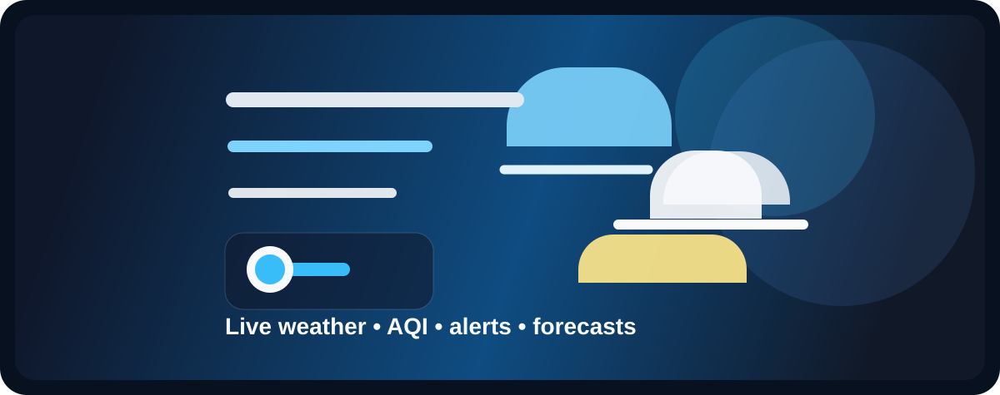

<div align="center">

</div>

# 🌤️ WeatherDash

[](https://reactjs.org/)
[](https://vitejs.dev/)
[](https://www.typescriptlang.org/)
[](https://tailwindcss.com/)

WeatherDash is a modern weather and environmental dashboard built with React, TypeScript, and Vite. It combines live weather data, air quality insights, earthquake and tsunami alerts, historical trends, and smart recommendations in a single polished dashboard.

## ✨ Features

- Live weather overview with temperature, humidity, visibility, wind, and pressure
- Air quality monitoring with AQI summaries and environmental context
- Earthquake and tsunami alert widgets with fallback data handling
- Historical weather and AQI charts for trend analysis
- Rule-based suggestions for clothing, outdoor activity, and comfort
- Accessibility settings for text size, contrast, and reduced motion
- Progressive Web App support with manifest and service worker

## 🛠️ Tech Stack

- Frontend: React 19, TypeScript, Tailwind CSS
- Build Tool: Vite
- Charts: Recharts
- Icons: Lucide React
- Data Fetching: Axios
- Date Utilities: date-fns
- Deployment: Cloudflare Pages via Wrangler

## 🚀 Getting Started

### Prerequisites

- Node.js 18 or newer
- npm

### Installation

1. Clone the repository
   ```bash
   git clone https://github.com/linnhtetwin/weather-dash.git
   cd weather-dash
   ```

2. Install dependencies
   ```bash
   npm install
   ```

3. Start the development server
   ```bash
   npm run dev
   ```

The app will be available at http://localhost:3000.

### Environment

This project uses public APIs such as Open-Meteo and USGS, so no API key is required for local development. If you need to customize the deployment URL, copy [.env.example](.env.example) to .env and update the value as needed.

## 🧪 Build

To create a production build:

```bash
npm run build
```

## 🚀 Deployment

The project includes a deployment script for Cloudflare Pages:

```bash
npm run deploy
```

## 📁 Project Structure

- src/App.tsx — main dashboard layout and state orchestration
- src/components — reusable dashboard widgets and pages
- src/services/api.ts — data fetching for weather, AQI, earthquakes, and tsunami alerts
- src/lib — utilities and unit conversion helpers

## 🤝 Contributing

Contributions are welcome. Feel free to open an issue or submit a pull request with improvements or bug fixes.

## 📄 License

This repository is currently unlicensed. Please contact the maintainer before using it in a commercial project.
